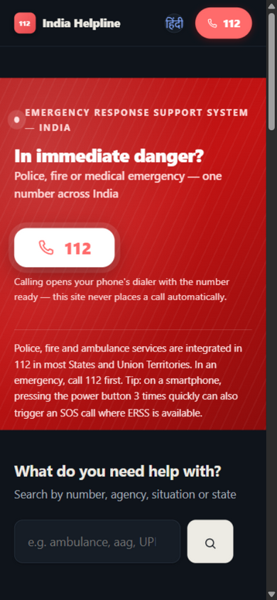
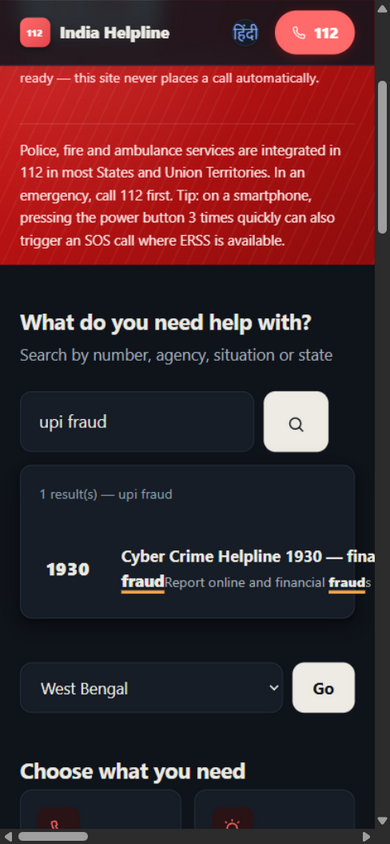
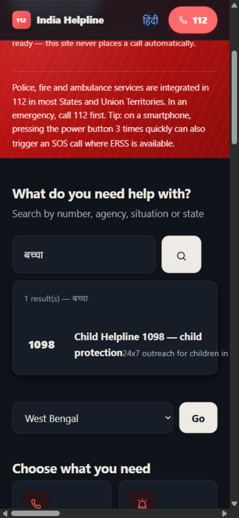
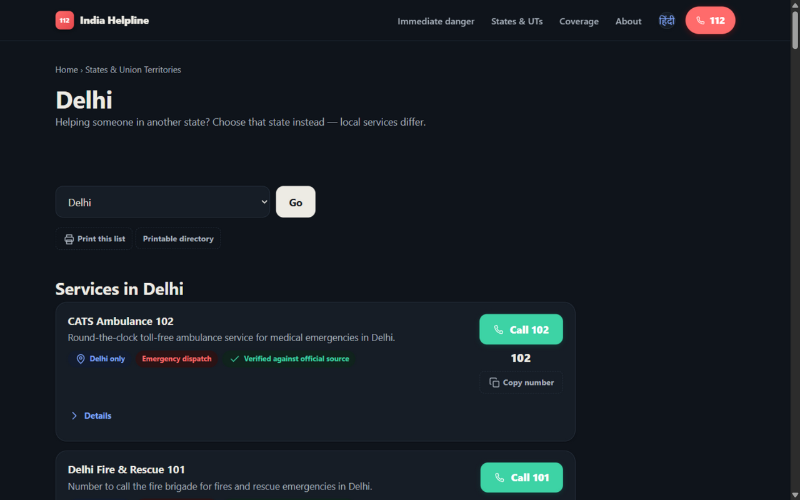
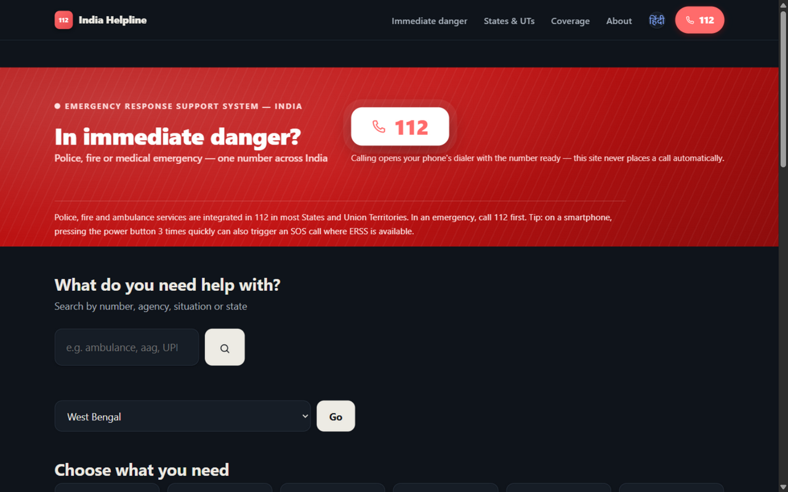

<div align="center">


**[🌐 Open the live site](https://siddhant-pardeshi.github.io/india-helpline/) · [हिंदी में खोलें](https://siddhant-pardeshi.github.io/india-helpline/hi/) · [📍 Coverage & honesty report](https://siddhant-pardeshi.github.io/india-helpline/coverage.html) · [🖨 Printable directory](https://siddhant-pardeshi.github.io/india-helpline/print.html) · [🔊 1:50 voice walkthrough](assets/voice/walkthrough.mp3)**

  -orange)    

</div>

---

## 🔊 Listen to the walkthrough — a cute voice tour of the whole project

<div align="center">

**[▶ PRESS PLAY — meet India Helpline in 1 minute 50](assets/voice/walkthrough.mp3)**

*A friendly voice walks you through the big idea: why 112 comes first, how every number gets verified,*
*the search that forgives typos and speaks Hindi, and why your searches never leave your phone.*

<details>
<summary>📖 Prefer reading? Full transcript</summary>

> Hii everyone! I'm going to walk you through India Helpline in just one minute — I promise it's worth it!
>
> Here's the big idea: when something goes really wrong, you don't want a website… you want a number. So the very first thing you see is a huge, friendly — **Call 112** — police, fire, or medical emergency, anywhere in India. One tap, and your phone dials it. The site never calls by itself — you're always in control.
>
> And here's my favourite part: **every single number here is verified.** A real person opened the official government page, matched the digits, and linked the source right on the card — with the date it was checked. If something can't be verified, it simply isn't published. Honest gaps are better than wrong numbers!
>
> Now, the search — this is the fun part! Type "UPI fraud" — or even "UPI frad" with a typo — and boom: **1930**, the cyber crime helpline that can freeze your money before it disappears. Type *bachcha* — that's Hindi for child — and **Childline 1098** appears, twenty-four seven. *Aag? Gaadi? Samudra?* It understands how people actually talk.
>
> Privacy? There is nothing to collect. No tracking, no ads, no location permission — your searches never leave your phone. And once you visit, the whole directory saves itself for offline use — perfect for a mountain trek with zero signal bars. Found a wrong number? There's a **Report Incorrect Details** button on every single card.
>
> That's it! Stay safe out there — and remember: in an emergency, it's always **112** first. Byeee!

</details>

</div>

---

## 📸 The live product — real screenshots, every tab

<div align="center">
<table>
<tr>
<td width="50%" align="center"><b>🚨 The first screen answers first</b><br><sub>112 before anything else — selectable text beside a native <code>tel:</code> link. Works with JavaScript disabled.</sub></td>
<td width="50%" align="center"><b>🔍 Search that forgives humans</b><br><sub>Typo "upi frad" → the verified 1930 card, one tap to dial, scope + source + check date on every result.</sub></td>
</tr>
<tr>
<td width="50%"></td>
<td width="50%"></td>
</tr>
<tr>
<td width="50%" align="center"><b>🇮🇳 Speaks actual Hindi</b><br><sub>Type <b>बच्चा</b> in Devanagari → बाल हेल्पलाइन 1098. A built-in transliterator bridges scripts in both directions.</sub></td>
<td width="50%" align="center"><b>🏙 State pages with real local data</b><br><sub>Delhi: 10 locally-verified services first, then the 28 national ones. Another state's control room can never appear here.</sub></td>
</tr>
<tr>
<td width="50%"></td>
<td width="50%"></td>
</tr>
<tr>
<td width="50%" align="center"><b>🪪 Every dial button is defensible</b><br><sub>Native <code>&lt;details&gt;</code> reveals operator, hours, charges, languages, notes, the source link and the exact date checked.</sub></td>
<td width="50%" align="center"><b>🧾 Honesty as a feature</b><br><sub>The coverage page declares what's verified in each jurisdiction — and exactly where local info is still missing.</sub></td>
</tr>
<tr>
<td width="50%"></td>
<td width="50%"></td>
</tr>
</table>

<sub>Desktop, the full Hindi site (<code>/hi/</code>), and the print layout ship too — <a href="assets/readme/screenshots/home-desktop.png">desktop home</a> · <a href="assets/readme/screenshots/home-hindi.png">हिंदी home</a></sub>
</div>

---

## 🎬 Watch the search understand a real human

<div align="center">

</div>

The search engine is hand-built (zero libraries) around one insight: **people in distress don't type clean queries.**

- **Typo tolerance** — bounded edit-distance matching (`upi frad` → *fraud*, d=2 gated by word length so "leak" ≠ "legal")
- **Script bridging** — a Devanagari→Latin transliterator folds बच्चा/आग/गाड़ी into the same haystack as `bachcha`/`aag`/`gaadi`
- **Hindi + English names, purposes and aliases** all scored in one index
- **Synonym map** — *aag→fire, zeher→poison, samudra→coast guard, dhokha→fraud…*
- **Urgency-weighted ranking** — emergency categories outrank advice lines
- **Scope isolation** — pick your state and another state's local numbers are *hard-excluded*, never merely demoted
- **Numbers are searchable** — type `1930` and find the service
- **Keyboard-navigable** results with visible focus, `aria-live` status, debounced 90 ms

---

## 🧭 The problem, and why it's harder than it looks

**The moment:** someone on a railway platform at 2 AM, a father with a convulsing child, a student whose UPI account just drained. They don't want a website. They want *the right number, right now*.

**Why existing answers fail:**

| Failure | Consequence |
|---|---|
| Directory sites copy each other's numbers | Stale/wrong numbers propagate; a wrong "help" number is worse than none |
| Emergency numbers buried under hero banners and ads | Seconds matter; every scroll costs |
| English-only search | The person who needs help most often thinks in Hindi or a transliteration |
| Assumed coverage ("this works everywhere!") | A Delhi piped-gas line is useless in Kerala — and misleading |
| Auto-diallers and "request help" buttons | False reassurance; nothing is actually dispatched |
| Heavy SPAs | Dies on a ₹4,000 phone with one bar of 2G — precisely where emergencies happen |

**The deeper problem:** trust. A helpline directory is only as good as its *worst* number. So this project treats verification as the product, not a feature.

## 💡 The solution — three non-negotiable principles

1. **The emergency comes first.** `112` is the first thing on the first screen — a giant red call action that opens the phone's dialer (never auto-dials), rendered as selectable text beside the native `tel:` link, present in the header of every page, functional with JavaScript disabled.
2. **No evidence, no listing.** A number ships only after its digits, operator, purpose and jurisdiction are matched against the operator's *own* official page — and the card then carries that source link and the check date forever. Conflicts get quarantined with a written reason; unverifiable leads live in `data/leads.md`, never on the site.
3. **Honest gaps beat confident wrongness.** Four jurisdictions (AR, AS, LA, LD) have no verified local numbers yet. Their pages and the coverage page say exactly that, instead of showing something approximate.

<div align="center">

</div>

---

## ✨ Every feature, explained

### 🚨 Emergency-first interface
- **112 hero** with a breathing ring (honors `prefers-reduced-motion`), selectable digits, one-tap `tel:112` — and a sticky `112` chip in the header of all 100+ pages.
- No splash, no carousel, no cookie banner, no sign-in. The home page works before any choice is made.
- Explicit disclosure: *this site lists contacts; it does not receive emergency requests and never places calls.*

### 🔍 Instant search (the engine above)
Built for stress: no network round-trips, everything runs locally against a compact JSON index — see the animated demo. Empty states redirect to 112 and to category browsing, never to a dead end.

### 🗺️ Region-aware directory
- Manual **state/UT selector** (36 jurisdictions, ISO codes) — no location permission, ever.
- State pages: **locally verified services first**, then national services clearly labelled "Applies across India".
- **Cross-state help:** in Delhi helping family in Assam? Pick Assam — the selector is about *where help is needed*, not where you are.
- Search + category filters honor the chosen region instantly (the selector persists on change).

### 🏗️ Defensible data layer
```json
{ "id": "national-cybercrime-1930",
  "operator": "Indian Cyber Crime Coordination Centre (I4C), MHA",
  "displayNumber": "1930", "dial": "1930",
  "scope": "national", "hours": "Hours not published",
  "charges": "toll-free",
  "sourceUrl": "https://i4c.mha.gov.in/ncrp.aspx",
  "evidence": "…helpline number 1930 is running in all States/UTs.",
  "checkedDate": "2026-11-09", "status": "published" }
```
- Stable IDs, EN+HI names/purposes, aliases, languages, channels (SMS/WhatsApp/web only when the operator documents them), notes, evidence quote, check date, lifecycle status (`published` / `quarantined` + reason).
- **Never inferred:** 24×7, toll-free, nationwide scope, anonymity — only published when the source says so. `"Hours not published"` is a valid, honest value.
- Short codes (≤5 digits) never get `+91`; STD landlines dial as `+91-STD-number` with digit-equivalence validated.

### 🛡️ The publish gate (`src/validate.mjs`)
A hard gate, not a lint suggestion — the build refuses to ship dirty data: required fields, unique IDs, duplicate number+scope detection, dial↔display digit equivalence (incl. STD `0`→`+91`), scope code validity, HTTPS-only sources, future/stale check dates, status hygiene (quarantined records must carry reasons), plus a `node --check` syntax gate on every shipped script.

### 🇮🇳 True bilingual (not a translate widget)
- **Complete parallel Hindi tree** at `/hi/` — every page, every empty state, every emergency action.
- Language switch preserves the current page/filters; `hreflang` + canonicals are generated per page.
- Interface language stays distinct from *operator* languages (documented per record when the source states them).
- Devanagari search works natively (transliterator above). English fallback shows if a Hindi description is missing.

### 📴 Offline-first PWA
- Service worker (scope-aware — works at site root *and* under the GitHub Pages sub-path) caches the directory on first visit.
- Offline banner states the **saved date**; the footer pill shows it too.
- **Network-first navigations** mean a withdrawn record disappears on the visitor's next online visit — stale numbers can't linger offline.
- Graceful offline fallback page that still offers `tel:112`.

### 🔐 Privacy by architecture
No accounts, no analytics, no ads, no third-party requests (fonts/icons/SVGs are bundled), no geolocation, **search terms never leave the device** and never enter URLs or logs. Location is a manual dropdown. "Report incorrect details" is a pre-filled mailto to the owner channel — clearly labelled as unable to send help.

### ♿ Accessibility (WCAG 2.2 AA targets)
Semantic headings, skip-link, visible focus everywhere (including keyboard-navigated search results), 44px+ touch targets, `aria-live` search status, tabular numerals for numbers, 320px-safe layout, light+dark themes, all motion behind `prefers-reduced-motion`. Every design token's contrast was verified programmatically (all pairs ≥ 4.5:1 after we fixed the ones that weren't).

### 🖨️ Print & share
`/print.html` — plain list of numbers, scope and check dates, `print`-optimized CSS (cards avoid page breaks, chrome hidden). Built for noticeboards at home, schools, workplaces, panchayat offices.

### 🧾 Governance
`MAINTENANCE.md` documents the named-owner review cycle (180-day interval, dispatch lines monthly), the exact "verify a replacement source" workflow, retire/rollback procedure, and the owner-contact handoff. `data/leads.md` is the quarantine ledger of unverified leads. `CHANGELOG.md` records every data change with reasons.

---

## 🧪 Engineering rigor — bugs we found in ourselves

Shipped *after* fixing, each verified end-to-end:

| Bug | Root cause | Fix |
|---|---|---|
| SW registration silently failing on every page | `await` inside a non-async `.then()` (syntax error) introduced by a string-patch that only replaced the first match | Fixed both functions; added a `node --check` **syntax gate** to the build |
| Service worker killing controlled navigations (`ERR_FAILED`) | `cache.put()` called on a `Promise` (not the resolved cache) inside `respondWith` | Resolve the cache first; harden with catch → offline fallback |
| `fetch()` rejecting navigations | navigation `Request` objects have `mode: 'navigate'` which `fetch()` forbids | Always fetch by URL string |
| Search crashed on all 72 state pages | `wireRegion` assumed a `<form>`; state pages use a button → null deref killed the whole boot chain | Handle both; Go-button navigation verified |
| Wrong state's numbers leaking into search | Out-of-state penalty (−200) couldn't beat a strong text match — a WB user saw Delhi's piped-gas line | **Hard exclusion** of other states' local records |
| Region ignored until "Go" pressed | Persist-on-submit only | Persist on change — search is region-aware instantly |
| Hindi-script search returned nothing | Index/aliases were Latin-only | Devanagari transliterator + HI fields in the haystack |
| False-positive matches ("gas leak" → legal aid) | Edit-distance too loose for short words | d≤1 below 6 chars, deduped pools, best-match only |
| Header/hero flush-left at narrow widths | double-class padding override (`wrap topbar-in`) zeroed horizontal padding | `padding-block` split |
| Mobile horizontal overflow | fluid grid tracks (`1fr`) can't shrink below content | `minmax(0,1fr)` everywhere; shrinkable select |
| Contrast failures (3.0, 2.5, 3.1) | faint/saffron tokens + dark-mode button text | New tokens; all pairs verified ≥ 4.5:1 |
| PWA shortcuts 404 on Pages | root-absolute URLs under a sub-path | relative URLs |
| Offline pill never showed its date | client never asked the SW | request/response message wired |

---

## 🏗️ Architecture & stack

```
data/records/*.json  ─┐
i18n/{en,hi}.json    ─┤   src/build.mjs (zero-dependency Node)
data/states.json     ─┤        │  validate.mjs gates publish
                      ┘        ▼
                    site/  ── static HTML ×2 language trees (100+ pages)
                      │        directory.json (search index + offline data)
                      │        sw.js (scope-aware offline cache)
                      └──────► GitHub Pages  ──► https://…/india-helpline/
```

- **Zero runtime dependencies.** The whole toolchain is one dependency-free Node build script; output is plain static files — hostable anywhere for ~₹0.
- **~40 KB HTML first load**; search index injected only where search lives.
- **Deploy:** `main` holds source; a clean worktree push of the built `site/` goes to `gh-pages`. `--site-url`/`--base-path` flags generate canonicals, hreflang and a 102-URL `sitemap.xml`.

### Run it locally
```bash
node src/validate.mjs        # must print RESULT: PASS
node src/build.mjs           # → site/
npx serve site               # or any static server
```

### Add or fix a listing (the 5-minute workflow)
Open the operator's official page → confirm digits/operator/purpose/jurisdiction → add the record with `evidence` + today's `checkedDate` → validate → build → deploy → changelog. Full guide: [MAINTENANCE.md](MAINTENANCE.md).

---

## 🗺️ Roadmap

- [ ] Close the 4 declared gaps (AR · AS · LA · LD) — official pages needed (AR was blocked by research tooling, not by missing data)
- [ ] District-level depth for high-population states (Mumbai, Bengaluru, Kolkata…)
- [ ] Additional regional languages (MR, TA, BN, GU, KN…) once wording can be officially verified
- [ ] Community submissions through a PR template with the evidence-quote requirement enforced
- [ ] Quarterly automated source-link liveness checks

## 📊 Repository map

```
├── data/records/national*.json   # 28 verified national services
├── data/records/states/*.json    # 165 state/UT records (north/south/east/final batches)
├── data/leads.md                 # unverified leads — never rendered
├── i18n/{en,hi}.json             # every UI string
├── src/build.mjs                 # the generator (syntax-gated)
├── src/validate.mjs              # the publish gate
├── src/assets/                   # design system, client search, service worker
├── assets/readme/                # animated SVGs + real screenshots + voice tour
├── MAINTENANCE.md · CHANGELOG.md · README.md
```

## 🤝 Contributing

The best contribution is a **verified number**: open a PR adding a record with `sourceUrl` + `evidence` quote + `checkedDate`. A maintainer re-opens the source before merging — the gate runs in CI-spirit even without CI. Found a wrong number on the site? Use "Report incorrect details" on that card, or open an issue.

## ⚖️ Notes

Independent public-service project — **not a government website**. Numbers belong to their operators; the operators' own pages (linked on every card) are the source of truth. In an emergency, call **112**. This project never places calls automatically.

---

<div align="center">



<sub>↻ the rings turn, the beacons glow, the number stays the same: <b>112</b> — police · fire · medical, anywhere in India.</sub>

**Built by <span style="background:linear-gradient(90deg,#B45309,#0B7A5E,#1D4ED8,#B45309);background-size:250% 100%;-webkit-background-clip:text;background-clip:text;color:transparent">Siddhant Pardeshi</span> — for public welfare. 🇮🇳**

**If this repo could help someone at 2 AM, a ⭐ is how it finds them.**

</div>
