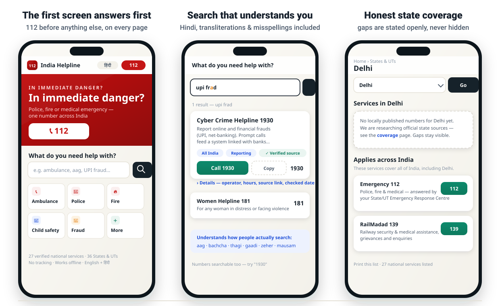
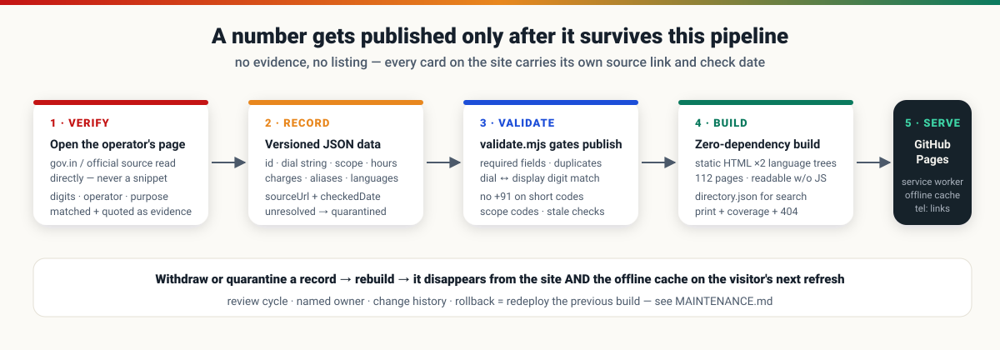

<div align="center">



**[🌐 Open the live site](https://siddhant-pardeshi.github.io/india-helpline/) · [हिंदी में खोलें](https://siddhant-pardeshi.github.io/india-helpline/hi/) · [Coverage & honesty report](https://siddhant-pardeshi.github.io/india-helpline/coverage.html) · [Printable list](https://siddhant-pardeshi.github.io/india-helpline/print.html)**

  -success)   

</div>

---

## 🔊 Listen to the walkthrough — a cute voice tour of the whole project

<div align="center">

**[▶ PRESS PLAY — meet India Helpline in 1 minute 50](assets/voice/walkthrough.mp3)**

*A friendly voice walks you through the big idea: why 112 comes first, how every number gets verified,*
*the search that forgives typos and speaks Hindi, and why your searches never leave your phone.*

*(click → GitHub opens its built-in audio player)*

<details>
<summary>📖 Prefer reading? Full transcript</summary>

> Hii everyone! I'm going to walk you through India Helpline in just one minute — I promise it's worth it!
>
> Here's the big idea: when something goes really wrong, you don't want a website… you want a number. So the very first thing you see is a huge, friendly — **Call 112** — police, fire, or medical emergency, anywhere in India. One tap, and your phone dials it. The site never calls by itself — you're always in control.
>
> And here's my favourite part: **every single number here is verified.** A real person opened the official government page, matched the digits, and linked the source right on the card — with the date it was checked. If something can't be verified, it simply isn't published. Honest gaps are better than wrong numbers!
>
> Now, the search — this is the fun part! Type "UPI fraud" — or even "UPI frad" with a typo — and boom: **1930**, the cyber crime helpline that can freeze your money before it disappears. Type *bachcha* — that's Hindi for child — and **Childline 1098** appears, twenty-four seven. *Aag? Gaadi? Samudra?* It understands how people actually talk.
>
> Privacy? There is nothing to collect. No tracking, no ads, no location permission — your searches never leave your phone. And once you visit, the whole directory saves itself for offline use — perfect for a mountain trek with zero signal bars. Found a wrong number? There's a **Report Incorrect Details** button on every single card.
>
> That's it! Stay safe out there — and remember: in an emergency, it's always **112** first. Byeee!

</details>

</div>

---

## Someone on a railway platform, at 2 AM, doesn't want a website. They want a phone number.

**India Helpline** is an independent public-service directory built for that moment. The first screen is one giant question — *"In immediate danger?"* — and one giant answer: **112**. Everything else — 27 national services, all 36 States & UTs, English and हिंदी — exists to get a person to the *right* number in seconds, and to get out of the way.

<div align="center">

</div>

## The rule that shaped everything: no evidence, no listing

Every number is published **only** after its digits, operator, purpose and jurisdiction are matched against the operator's own official page — and every card shows its [source link](https://i4c.mha.gov.in/ncrp.aspx) and the date it was checked. When sources conflict, the record is held back and the gap is stated openly on the [coverage page](https://siddhant-pardeshi.github.io/india-helpline/coverage.html) — because a wrong "help" number is worse than an honest blank.



## What you can search for

The search understands how people actually look for help — including **Devanagari script**, romanised Hindi, and misspellings:

| You type | You get |
|---|---|
| `upi frad` *(misspelled)* | **1930** — Cyber Crime Helpline, banks can freeze the fraud |
| `medical help on train` | **139** — RailMadad security & medical assistance |
| `बच्चा` *(Devanagari)* | **1098** — Child Helpline, 24x7 |
| `aag` / `आग` | **112** first, then fire-related lines |
| `gaadi` / `train` | **139 · 182** — railway assistance & RPF security |
| `samudra` / `boat` | **1554** — Coast Guard maritime rescue |
| `gas leak` *(in a state with no local listing)* | an honest "nothing local verified" + 112 — never another state's number |

## Engineering notes

- **Zero runtime dependencies** — a dependency-free Node build script generates 112 static pages ×2 language trees. `node src/build.mjs` is the whole stack.
- **Offline by design** — a service worker caches the directory; the offline banner shows the saved date; withdrawn records vanish from the cache on the visitor's next refresh. Navigations are network-first so retracted numbers can't linger.
- **Defensible data layer** — `validate.mjs` gates publishing: required fields, duplicate detection, `tel:` digit ↔ display-number equivalence (including STD `0` → `+91`), short codes never prefixed with `+91`, HTTPS sources only, staleness warnings.
- **WCAG 2.2 AA targets** — semantic headings, visible focus, 44px+ targets, `aria-live` search status, 320px-safe, reduced-motion support, light **and** dark theme.
- **Privacy as architecture** — no account, no analytics, no geolocation, no third-party requests of any kind. Search terms never leave the device.

## Repo layout

```
├── data/
│   ├── states.json              # official 36 jurisdictions (ISO 3166-2)
│   └── records/                 # verified records — the heart of the repo
│       ├── national.json        # 112, 139, 181, 1098…
│       ├── national-health.json # 108/102, Tele-MANAS 14416, poison centres…
│       ├── national-travel.json # 182, 1033, 1363, 1078, 1554, NDRF…
│       └── states/              # state/UT-level records (research in progress)
├── i18n/en.json · hi.json       # every UI string, both languages
├── src/
│   ├── build.mjs                # the site generator
│   ├── validate.mjs             # the publish gate
│   ├── lib/                     # templates + SVG icon system
│   └── assets/                  # design system, client search, service worker
├── assets/readme/               # hand-drawn SVG banner, screens, architecture
├── MAINTENANCE.md               # review cycle, retirement workflow, rollback
└── CHANGELOG.md                 # what changed, when, why
```

## Run it

```bash
node src/build.mjs      # → site/  (English at /, Hindi at /hi/)
node src/validate.mjs   # must print RESULT: PASS
# then serve site/ statically — any web server works
```

## Tested, not assumed

Every release walks the acceptance scenarios: narrow phone with JS disabled → **112 still visible and dialable**; `medical help on train` → railway assistance; `UPI fraud` → the verified reporting route; cross-state search → never shows another state's control room as local; Hindi user → same number on screen as in the dialer; offline visitor → saved numbers + cache date; quarantined record → absent from site *and* cache.

## Found a wrong number?

Every listing has **"Report incorrect details"** — it opens a pre-filled mail to the owner channel and cannot send help. For any emergency, call **112**; this site never places calls automatically.

---

<div align="center">

*Built as an independent public service — not a government website. Numbers belong to their operators; the operators' own pages, linked on every card, are the source of truth.*

**If this repo helps you, a ⭐ helps it reach someone who might need it at 2 AM.**



*⚡ The badge pulses, the cycle glows and the numbers march — this footer is a live animation, no JavaScript required.*

</div>
